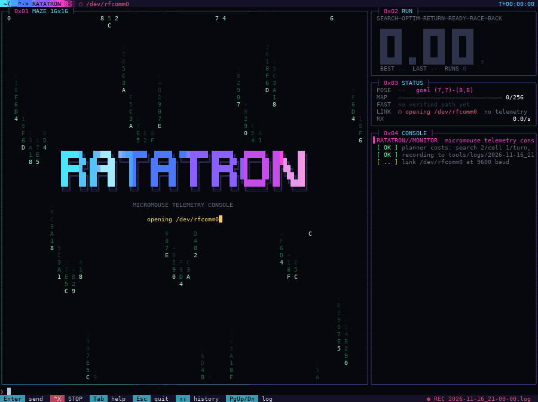

<p align="center"></p>

# RATATRON

A micromouse: an STM32F103 robot that explores an unknown maze, maps it, works out the fastest route and runs it,
with smooth curves. Board, body, firmware, PC tools and a simulator, all here
([javierih.com/robots/ratatron](https://javierih.com/robots/ratatron/)).



- **Search** (mode 1): explores to the goal, keeps exploring only what could still shorten the fast path, returns
  and saves the map in flash.
- **Speed run** (mode 2): the verified path in one continuous move, straights at `FAST`, curves at `CURVE`, and back.
  The planner minimises time, not cells.

## Quick start

```
software/install.sh          # the `ratatron` command
ratatron connect &           # the robot over Bluetooth: recorded, shared
ratatron monitor             # the live maze and console
ratatron flash practice      # build and flash (competition: the 16x16 goal)
```

## Where things are

- [firmware/](firmware/): the robot's code (PlatformIO, bare STM32 HAL) and its PC tests
- [software/](software/): the `ratatron` tools (link, monitor, calibration) and the session logs
- [electronics/](electronics/) (KiCad), [mechanics/](mechanics/) (FreeCAD, STL)
- [docs/](docs/README.md): [using the robot](docs/usage.md) (buttons, LEDs, console), [the tools](docs/tools.md),
  design, measurements, tests, faults
- The simulator, the robot in MuJoCo with its real firmware (and other micromice with theirs):
  [ratasim](https://github.com/JavierIH/ratasim), its own repository (this one as a submodule)
- [AGENTS.md](AGENTS.md): architecture and conventions

## Licence

Code (`firmware/`, `software/`) and documentation: GPLv3 ([LICENSE](LICENSE)). Hardware (`electronics/`,
`mechanics/`): CC BY-SA 4.0 ([electronics/LICENSE](electronics/LICENSE), [mechanics/LICENSE](mechanics/LICENSE)).
