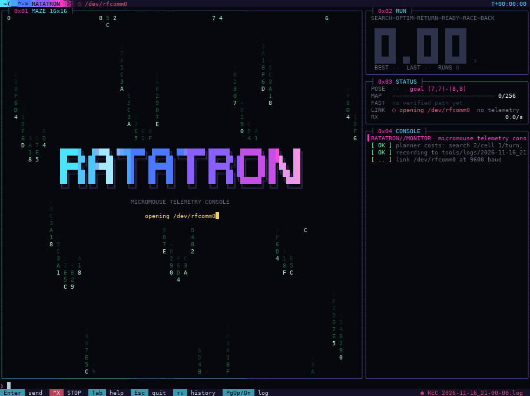

# software

The `ratatron` command: the robot's link, the live monitor and the calibration analysis (the MuJoCo simulator is
[ratasim](https://github.com/JavierIH/ratasim)).

```
./install.sh                 # a virtual environment in .venv, `ratatron` in ~/.local/bin
ratatron help
```

<p align="center"></p>

- `ratatron/`: the tools (`link/`, `monitor/`, `calib/`), one command each: [docs/tools.md](../docs/tools.md)
- `tests/`: the tools' tests (`ratatron test` runs these and the firmware's)
- `logs/`: every robot session (commit them after a session), `calib_data/`: the calibration recordings
- `scripts/`: small batches of console commands
